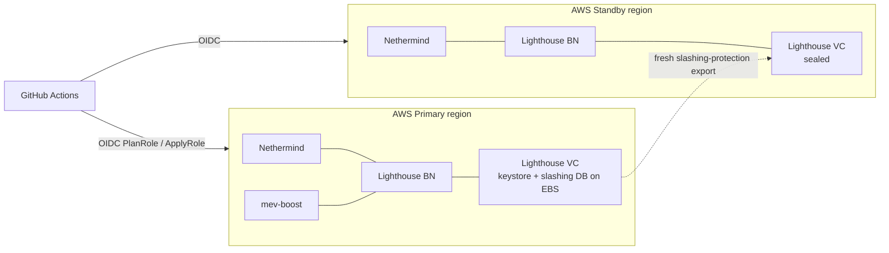

# Ethereum Validator Infrastructure

> Ethereum validator on AWS (Hoodi testnet) with a cross-region standby, built with Terraform, Ansible and
> GitHub Actions OIDC. Failover is planned and gated so that **two validator clients can never sign at the same time**.

Hoodi에서 AWS Primary validator와 타 리전 Standby node를 운영하는 IaC입니다.
핵심 목표는 리전 전환을 하면서도 **이중 서명(slashing)이 구조적으로 일어날 수 없게** 만드는 것입니다.

## Architecture

## Design decisions

| 결정 | 이유 |
|---|---|
| Standby VC는 **sealed** 상태로 대기, 자동 failover 없음 | 두 VC가 동시에 서명하면 slashing. 전환은 사람이 gate를 통과시켜야만 진행 |
| 전환 gate: fresh export → source EC2 hard fence → slashing protection import → two-person approval → doppelganger protection | 각 단계가 이전 signer가 확실히 멈췄음을 증명해야 다음 signer가 시작 |
| keystore와 SQLite slashing DB는 validator 상태 EBS에만 저장 | Git에는 example·template·검증기만. 실제 키와 export는 커밋하지 않음 |
| GitHub Actions는 OIDC PlanRole / ApplyRole, protected Environment | 장기 access key 없음, plan과 apply 권한 분리 |
| 모든 Actions를 커밋 SHA로 고정 | 공급망 공격 방지 |

## Operations

- Runbooks: [RB-01 Failover](shared/runbooks/RB-01-failover.md) · [RB-02 Failback](shared/runbooks/RB-02-failback.md) ·
  [RB-03 Slashing protection 재구성](shared/runbooks/RB-03-sp-reconstruction.md) · [RB-04 Key ceremony](shared/runbooks/RB-04-key-ceremony-restage.md)
- Drill: [D-1 계획 왕복 전환](drills/D-1-planned-roundtrip.md) — 기록은 `drills/records/`, 왕복 RTO는 `shared/scripts/compute-roundtrip-rto.py`로 계산
- Gate 도구: `shared/scripts/vc-gate.sh`, `check-fence-freshness.py`, `seal-keystores.sh`, `terraform-plan-gate.sh`

## Verification

- PR: Terraform·Ansible 정적 검증 워크플로 (`.github/workflows/*-pr.yml`)
- 계약 테스트: `tests/` — CI/CD IAM, OIDC 키 전달, 보안 그룹 allowlist, 공급망, deploy·teardown 워크플로 계약

---

## 강의 실습 안내 (Course 1)

이 저장소는 Hoodi에서 AWS Primary validator와 AWS 타 리전 Standby node를 Terraform, GitHub Actions OIDC와 Ansible로 구축하는 강의 실습 코드입니다. 강의 순서에 맞춰 작업 위치의 README를 실행 참조서로 사용합니다.

## 실행 순서

1. [`primary-aws/bootstrap/README.md`](primary-aws/bootstrap/README.md) - AWS 계정과 IAM Identity Center
2. [`.github/README.md`](.github/README.md) - GitHub Organization, ruleset, Environment와 PR
3. [`primary-aws/bootstrap/cicd/README.md`](primary-aws/bootstrap/cicd/README.md) - OIDC PlanRole/ApplyRole와 backend
4. [`primary-aws/terraform/README.md`](primary-aws/terraform/README.md) - AWS Primary 인프라
5. [`primary-aws/ansible/README.md`](primary-aws/ansible/README.md) - Primary EL·CL·Lighthouse VC·관측
6. [`standby-aws/terraform/README.md`](standby-aws/terraform/README.md) - AWS Standby 리전 인프라
7. [`standby-aws/ansible/README.md`](standby-aws/ansible/README.md) - Standby EL·CL과 sealed VC
8. [`shared/README.md`](shared/README.md) - key, slashing protection, gate와 운영 도구
9. [`drills/README.md`](drills/README.md) - 계획 failover와 failback

## Course 1 저장 경계

Lighthouse VC의 keystore와 SQLite slashing protection DB는 validator 상태 EBS에 둡니다. Git에는 example, template과 검증기만 저장하며 실제 `lab.env`, inventory, key, token, slashing export와 evidence는 커밋하지 않습니다.

## 배포 경계

GitHub Actions는 static PR 검증과 protected Environment의 OIDC PlanRole/ApplyRole을 사용합니다. 로컬 장기 access key는 만들지 않습니다. 실제 AWS account와 GitHub repository 값은 placeholder를 교체한 뒤 강의 순서대로 검토합니다.
